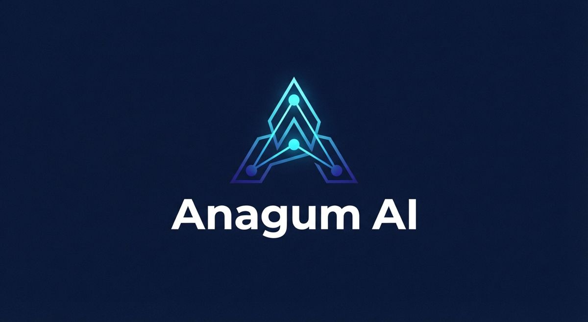

# Anagum AI landing page



Company site for Anagum AI, served at https://www.anagumai.com.

Static multi-page site: `index.html`, `about.html`, `contact.html`,
`ai-automations.html`, `ai-agents.html`, compiled `styles.css`,
`favicon.ico`, `apple-touch-icon.png`, `robots.txt`, `sitemap.xml`,
`images/`. No JavaScript, no
form. Photos other than the logo are by Annie Spratt and Sigmund via
Unsplash. Every page shares the same header nav and footer; keep them in
sync when editing.

Styling is Tailwind CSS plus daisyUI with one bespoke `anagum` theme,
compiled at author time and committed, so the deployed site stays plain
static files:

```sh
npm install
npm run build   # src/input.css -> styles.css
```

Pinned versions: see `package.json` devDependencies.

## Preview

```sh
python -m http.server 8123
```

then open http://localhost:8123.

## Deploy

Deployed to the Contabo VPS alongside `app.anagumai.com`. The VPS clones
this repo to `/srv/landing-page` and the `the-eye` proxy serves it; see
`deploy/contabo/SITE_WWW.md` in `the-eye` for the exact procedure.
To update the live site: push here, then `git pull` in `/srv/landing-page`
on the VPS.

